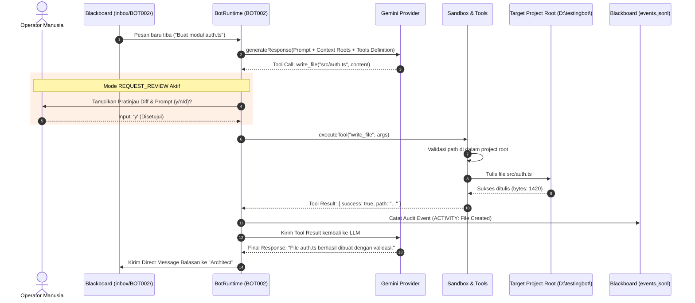
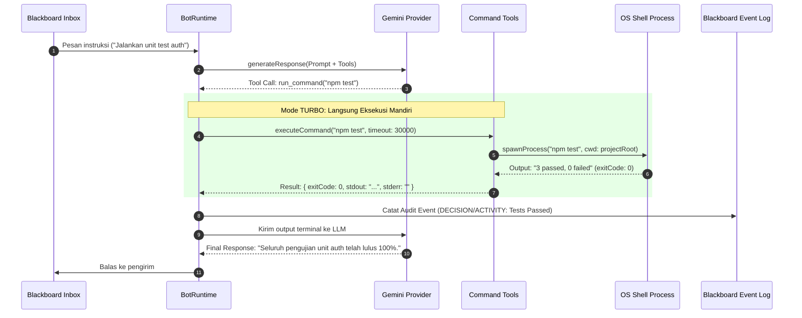

# Data Flows & Sequence Diagrams — Almudaya Multi-Agent v0.2.0

Dokumen ini memodelkan aliran data dan urutan interaksi temporal antara subsistem pada versi 0.2.0.

---

## 1. Aliran Data ReAct Loop dengan Mode `REQUEST_REVIEW`

Ketika sebuah bot (misal: "Coder") menerima instruksi koding dari bot lain (misal: "Architect") di bawah mode `REQUEST_REVIEW`:



---

## 2. Aliran Data ReAct Loop dengan Mode `TURBO`

Ketika bot dijalankan dengan flag `--mode turbo`, siklus eksekusi berjalan tanpa interupsi manusia:



---

## 3. Aliran Data Injeksi Konteks ke System Prompt

Sebelum memanggil model AI, sistem menyusun System Prompt secara dinamis dari Session Blackboard:

```
┌─────────────────────────────────┐
│ Identitas Bot                   │ -> Display Name, Bot ID, Role, Description
└────────────────┬────────────────┘
                 │
┌────────────────▼────────────────┐
│ Rekan Bot Aktif (Peer Registry) │ -> Daftar bot yang aktif di Session (misal: Architect, Reviewer)
└────────────────┬────────────────┘
                 │
┌────────────────▼────────────────┐
│ Target Project Roots            │ -> Path absolut folder proyek (misal: D:\testingbot)
└────────────────┬────────────────┘
                 │
┌────────────────▼────────────────┐
│ Aturan Perilaku & Format Tool   │ -> Definisi fungsi JSON (read_file, write_file, edit_file, run_command)
└────────────────┬────────────────┘
                 │
                 ▼
      [ Dynamic System Prompt ] ───► Dikirim ke Google Gemini API
```
