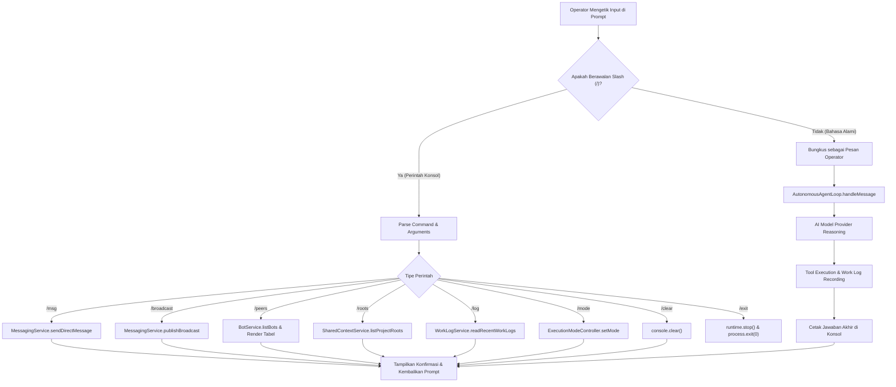
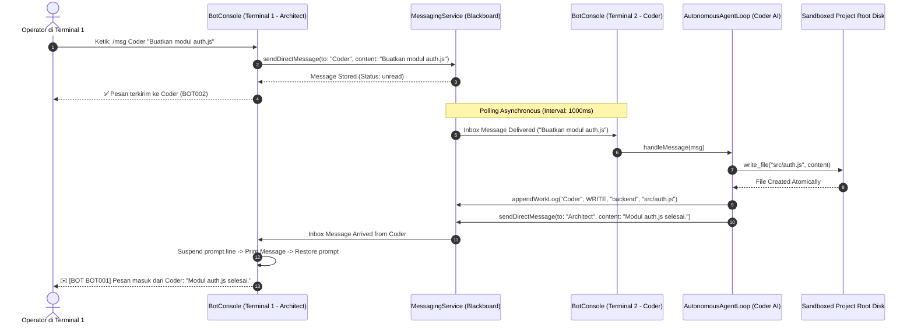
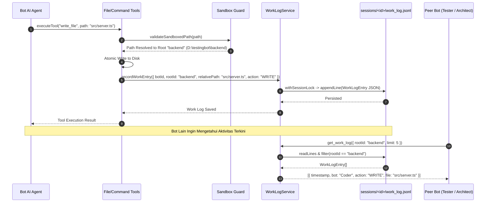

# Data Flows & Interaction Sequences — Almudaya Multi-Agent v0.3.0

Dokumen ini memodelkan diagram alir data dan urutan interaksi (*Sequence Diagrams*) untuk subsistem v0.3.0.

---

## 1. Alir Pemrosesan Perintah Konsol REPL

---

## 2. Diagram Urutan Pengiriman Pesan Antar-Terminal Melalui Konsol (`/msg`)

---

## 3. Diagram Alir Pencatatan & Pembacaan Memori Kerja Sesi (`work_log.jsonl`)

