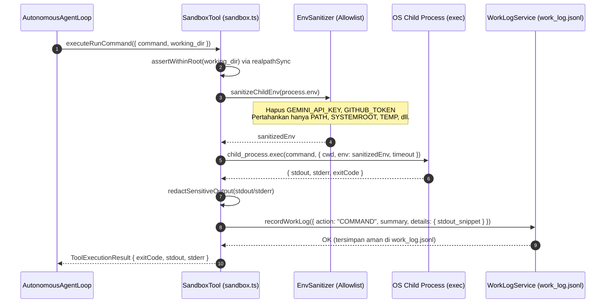
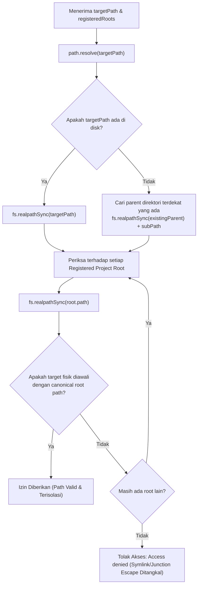
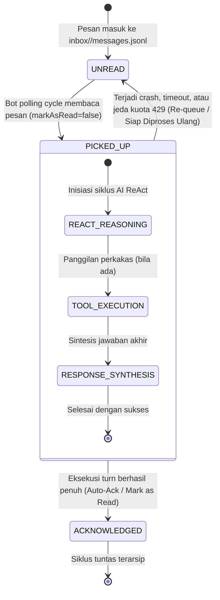
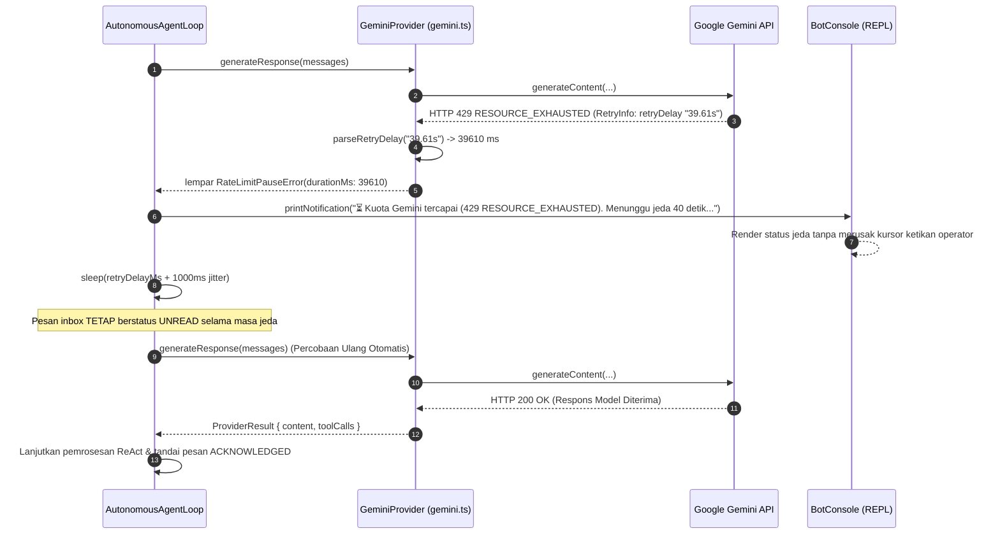

# Diagram Alir Data & Sekuens (Data Flows) — Almudaya Multi-Agent v0.3.1

Dokumen ini memvisualisasikan alur pemrosesan data, validasi keamanan, dan transisi status untuk rilis v0.3.1.

---

## 1. Eksekusi Shell Tersanitasi & Redaksi Output (`run_command`)

Diagram urutan berikut menggambarkan bagaimana variabel lingkungan dibersihkan sebelum subprocess shell dijalankan, serta bagaimana output divalidasi sebelum disimpan ke memori kerja:

---

## 2. Resolusi Kanonikal Filesystem Sandbox (`assertWithinRoot`)

Diagram alir berikut memvalidasi apakah suatu path target (berkas yang sudah ada atau berkas baru) lolos verifikasi isolasi kanonikal terhadap seluruh root proyek terdaftar:

---

## 3. Siklus Transaksional Pesan Inbox (*At-Least-Once Delivery*)

Diagram status berikut menunjukkan transisi status pesan inbox, menjamin bahwa kegagalan di tengah jalan tidak mengakibatkan pesan hilang:

---

## 4. Penanganan Adaptif Jeda Kuota Model Gemini (429 Throttling)

Diagram sekuens berikut menunjukkan alur penanganan respons 429 yang menenangkan operator dan mengotomatiskan jeda tunggu:

