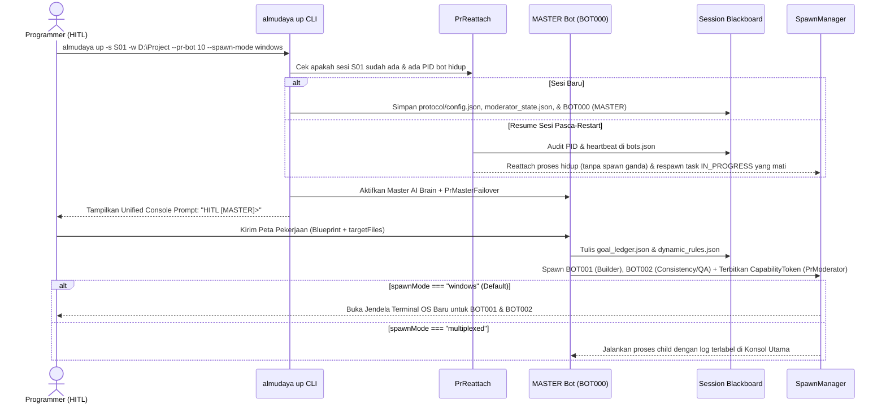
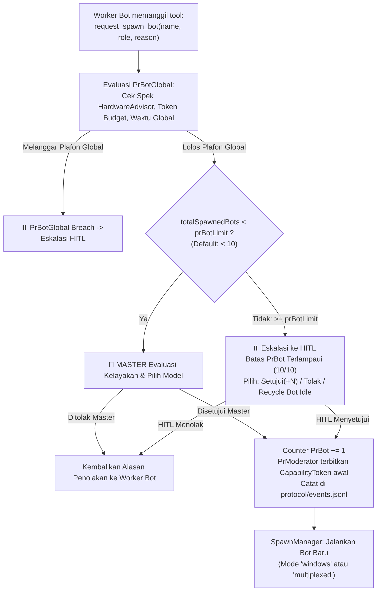
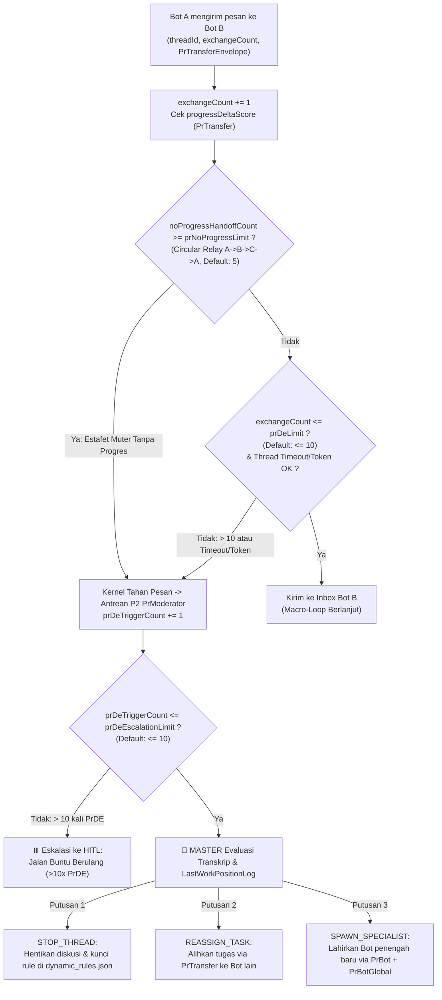
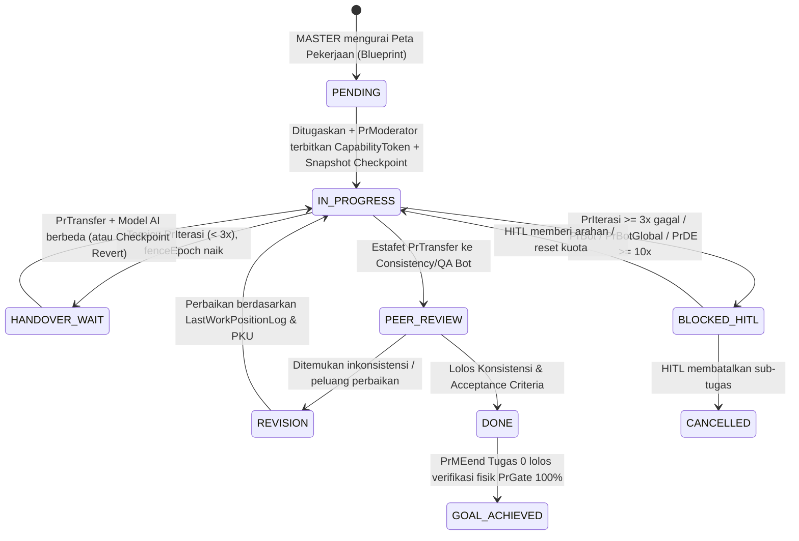
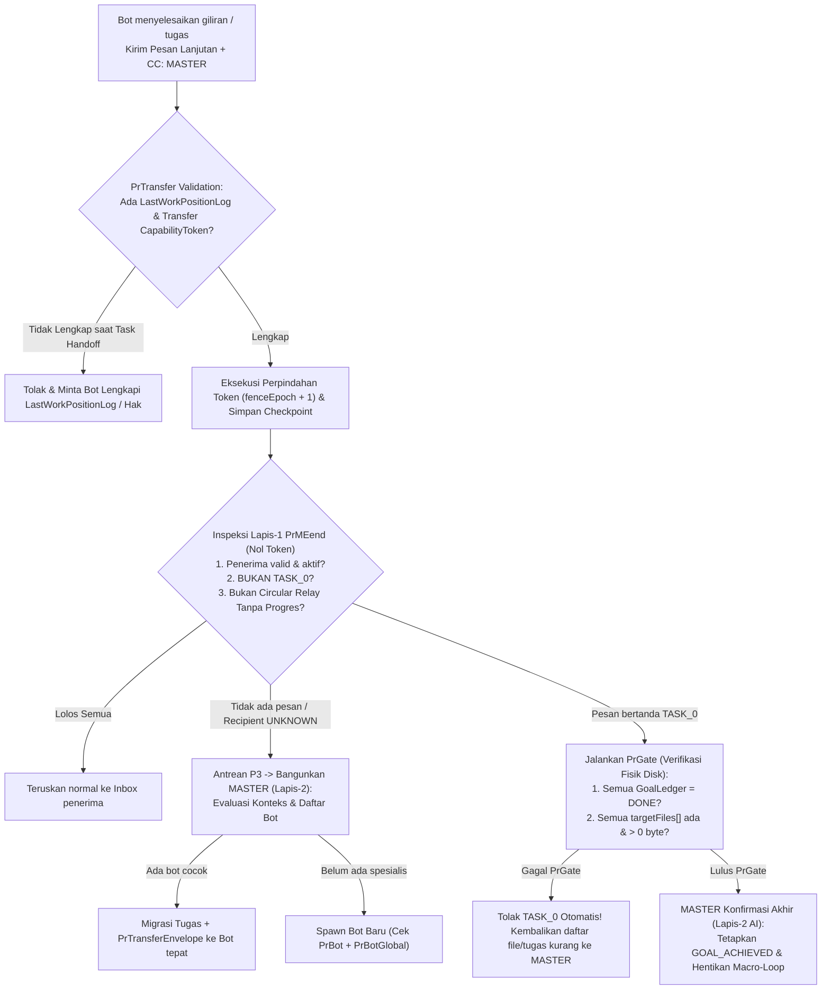
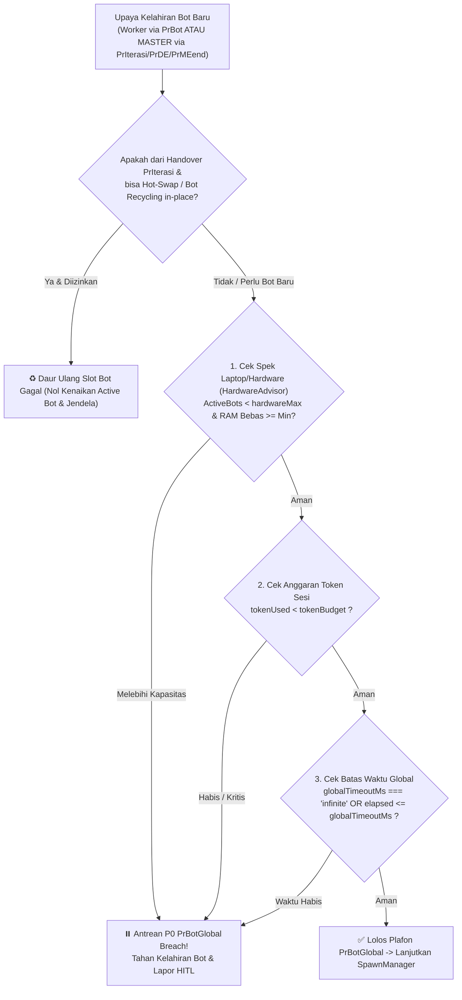

# Data Flows & Protocol State Machines — Almudaya Multi-Agent v0.3.5

Dokumen ini memvisualisasikan alur data dan transisi status untuk Startup `MASTER`, Macro-Loop, serta interaksi ke-10 Butir Protokol Atomic (`PrBot`, `PrBotGlobal`, `PrIterasi`, `PrDE`, `PrMEend`, `PrModerator`, `PrTransfer`, `PrMasterFailover`, `PrGate`, `PrReattach`).

---

## 1. Alur Startup & Peluncuran Bot Anak (`t = 0` + `PrReattach`)



---

## 2. Alur Protokol 1 — `PrBot` (Approval Pembuatan Bot Baru + `PrBotGlobal`)



---

## 3. Alur Protokol 2 — `PrIterasi` (Cross-Model Handover + Write Fencing + Checkpoint)

```mermaid
sequenceDiagram
    participant B1 as BOT001 (Model A)
    participant MOD as PrModerator
    participant TRF as PrTransfer
    participant K as PrIterasi
    participant M as MASTER (BOT000)
    participant B2 as BOT_NEXT (Model B != A / Recycled)
    actor HITL as Programmer (HITL)

    loop ReAct Micro-Loop (Task T-01)
        B1->>K: Cek iterasi, taskTimeoutMs, tokenBudget, status HTTP (402/429)
    end

    Note over B1,K: Terpicu! iteration >= prIterasiLimit (10) ATAU timeout ATAU kuota/402
    K->>MOD: Naikkan fenceEpoch (+1) & cabut CapabilityToken B1 (cegah zombie overwrite)
    K->>M: Masuk MasterInterventionQueue [Priority P1: PR_ITERASI_TRIGGERED]

    alt handoverCount < prIterasiHandoverLimit (Default: < 3)
        M->>TRF: Baca LastWorkPositionLog & status checkpoint T-01
        opt Berkas rusak parsial (NEEDS_REVERT)
            TRF->>TRF: Pulihkan file dari checkpoints/T-01/
        end
        M->>M: Pilih Model B (pool berbeda -> katalog -> single-model fallback)
        M->>K: handoverCount += 1; triedModels.push(B); Bot Recycling pada slot B1
        M->>TRF: Transfer T-01 + CapabilityToken (epoch baru) ke B2 via PrTransferEnvelope
    else handoverCount >= prIterasiHandoverLimit (Sudah 3x Gagal)
        M->>K: Set Task T-01 = BLOCKED_HITL
        M-->>HITL: Eskalasi Interaktif: "T-01 gagal setelah 3 percobaan. Putuskan aksi!"
    end
```

---

## 4. Alur Macro-Loop & Protokol 3 — `PrDE` (Ping-Pong & Circular Relay Detection)



---

## 5. Siklus Hidup Status Tugas di Goal Ledger (Macro-Loop + `PrGate`)



---

## 6. Alur Protokol `PrMEend`, `PrTransfer`, & Gerbang Objektif `PrGate`



---

## 7. Alur Protokol `PrBotGlobal` (Membatasi Semua Bot Termasuk `MASTER`)



---

## 8. Alur Protokol `PrModerator` — Antrean Prioritas P0–P5 & Delegasi Penengah

```mermaid
flowchart LR
    subgraph PARALEL["Event Paralel dari Jendela Anak (BOT001..BOT00N)"]
        E0["PrMasterFailover / PrBotGlobal"]
        E1["PrIterasi Triggered"]
        E2["PrDE DeadEnd"]
        E3["PrMEend / PrGate"]
        E4["PrModerator / PrTransfer Token"]
        E5["PrBot Spawn Proposal"]
    end

    PARALEL --> Q["MasterInterventionQueue (Serialized Priority Queue)<br/>Urutan Eksekusi: P0 -> P1 -> P2 -> P3 -> P4 -> P5"]

    subgraph MOD["Jabatan PrModerator"]
        M1["Default: MASTER (BOT000)"]
        M2["Delegasi Opsional: BOT_MOD (--moderator-bot)"]
    end

    Q --> MOD
    MOD -->|Terbitkan / Naikkan fenceEpoch| CAP["moderator_state.json<br/>(CapabilityToken Registry)"]
    CAP --> CHK["ExecutionModeController & ACG Policy Engine:<br/>Validasi tokenId + fenceEpoch setiap write_file/edit_file/run_command"]
```


