# Dependency Map (`Phase 0`)

**Target:** Internal module dependency graph across all 11 subsystems in `src/` and external runtime dependencies.

---

## 1. External Runtime Dependencies (`package.json`)

| Package | Version | Role in System |
|---|---|---|
| `@google/genai` | `^2.32.0` | Google Gemini SDK used exclusively by `src/ai/gemini.ts` (`GeminiProvider`). |
| `commander` | `^15.0.0` | CLI argument parser used exclusively by `src/cli/index.ts` and `src/cli/commands/*.ts`. |
| `zod` | `^4.6.7` | Runtime schema validation used across `session`, `bot`, `messaging`, `shared`, `capability`, and `core/jsonl.ts`. |
| Node.js built-ins | `>=22.12.0` (`v24.21.0` active) | `node:fs`, `node:fs/promises`, `node:path`, `node:os`, `node:process`, `node:crypto`, `node:child_process`, `node:readline`, `node:readline/promises`, `node:async_hooks` (`AsyncLocalStorage`). |

---

## 2. Subsystem Dependency Architecture (Mermaid)

```mermaid
flowchart TD
    CLI["src/cli/* (CLI Commands)"]
    IDX["src/index.ts (Public Barrel)"]

    subgraph BOT_SUB["Bot Runtime & Cognition (src/bot/*)"]
        CONSOLE["BotConsole (console.ts)"]
        LOOP["AutonomousAgentLoop (agent-loop.ts)"]
        RUNTIME["BotRuntime (runtime.ts)"]
        EXEC_MODE["ExecutionModeController (execution-mode.ts)"]
        BOT_SVC["BotService (service.ts)"]
    end

    subgraph TOOLS_SUB["Agent Tools (src/tools/*)"]
        FILE_T["file-tools.ts"]
        CMD_T["command-tools.ts"]
        MSG_T["messaging-tools.ts"]
        WL_T["work-log-tool.ts"]
        SANDBOX["sandbox.ts"]
    end

    subgraph AI_SUB["AI & Prompts (src/ai/*)"]
        PROMPTS["prompts.ts"]
        PROVIDER["provider.ts / gemini.ts / mock-provider.ts"]
        CREDS["credentials.ts"]
    end

    subgraph DOMAIN_SVC["Session, Messaging & Shared Services"]
        SESS_SVC["SessionService (session/service.ts)"]
        MSG_SVC["MessagingService (messaging/service.ts)"]
        DELIV_SVC["InboxDeliveryService (messaging/delivery.ts)"]
        SHARED_SVC["SharedContextService (shared/service.ts)"]
        WL_SVC["WorkLogService (shared/work-log.ts)"]
    end

    subgraph SEC_EXEC["Execution & Capability Governance"]
        EXEC_CTRL["ExecutionController (execution/controller.ts)"]
        ENV_BLD["ExecutionEnvironmentBuilder & redactSecrets (execution/environment.ts)"]
        ISO["IsolationBackends (execution/isolation/*)"]
        CAP_SVC["CapabilityService (capability/service.ts)"]
        POL_ENG["PolicyEngine (capability/policy-engine.ts)"]
        CAP_PERS["CapabilityPersistence (capability/persistence.ts)"]
    end

    subgraph BB_SUB["Blackboard Persistence (src/blackboard/*)"]
        BB_IF["IBlackboardStorage (interface.ts)"]
        BB_FS["FilesystemSessionStorage (filesystem.ts)"]
    end

    subgraph CORE_SUB["Core Utilities (src/core/*)"]
        LOCK["lock.ts (acquireLock / withLock / fencing)"]
        FS_U["fs-utils.ts (atomicWriteJson / readJsonValidated)"]
        JSONL["jsonl.ts (readJsonlFile / appendJsonlRecord)"]
        CFG["config.ts (resolveWorkspaceRoot)"]
        ERR["errors.ts (AlmudayaError hierarchy)"]
    end

    CLI --> SESS_SVC & BOT_SVC & RUNTIME & LOOP & CONSOLE & MSG_SVC & SHARED_SVC & CAP_SVC & BB_FS
    CONSOLE --> RUNTIME & LOOP & EXEC_MODE & BOT_SVC & MSG_SVC & SHARED_SVC & WL_SVC
    RUNTIME --> BOT_SVC & MSG_SVC
    LOOP --> BOT_SVC & MSG_SVC & SHARED_SVC & WL_SVC & EXEC_MODE & PROMPTS & PROVIDER
    LOOP --> FILE_T & CMD_T & MSG_T & WL_T & SANDBOX

    FILE_T --> EXEC_CTRL & SANDBOX
    CMD_T --> EXEC_CTRL
    MSG_T --> MSG_SVC
    WL_T --> WL_SVC

    MSG_SVC --> DELIV_SVC & BOT_SVC & BB_IF & ENV_BLD
    DELIV_SVC --> BOT_SVC & BB_IF
    BOT_SVC --> BB_IF & LOCK
    SESS_SVC --> BB_IF
    SHARED_SVC --> BB_IF
    WL_SVC --> BB_IF & ENV_BLD

    EXEC_CTRL --> CAP_SVC & ISO & ENV_BLD & SANDBOX
    CAP_SVC --> CAP_PERS & POL_ENG
    POL_ENG --> SANDBOX
    CAP_PERS --> LOCK & JSONL & FS_U & ENV_BLD & SANDBOX

    BB_FS -.implements.-> BB_IF
    BB_FS --> LOCK & FS_U & JSONL & CFG & ENV_BLD & ERR
```

---

## 3. Detailed Cross-Module Dependency Matrix

| Consumer Module | Depends On (`src/` Modules) | Direction & Coupling Notes |
|---|---|---|
| `src/core/*` | Only Node.js built-ins and `zod` | **Leaf layer.** Zero dependencies on any domain module. |
| `src/tools/sandbox.ts` | `node:fs`, `node:path`, `src/core/errors.ts` | **Near-leaf security utility.** Imported by `file-tools.ts`, `agent-loop.ts`, `policy-engine.ts`, `capability/persistence.ts`, `execution/controller.ts`. |
| `src/execution/environment.ts` | `node:path`, `node:process` | **Leaf security/redaction module.** Exports `redactSecrets`, `redactRecursively`, `registerSecret`, `ExecutionEnvironmentBuilder`. Imported by `blackboard/filesystem.ts`, `messaging/service.ts`, `shared/work-log.ts`, `capability/persistence.ts`, `execution/controller.ts`, `ai/gemini.ts`, `cli/commands/bot.ts`. |
| `src/blackboard/interface.ts` | Type-only imports from `session/schema.ts`, `bot/schema.ts`, `messaging/schema.ts`, `shared/schema.ts`, `shared/work-log.ts` | Pure TypeScript contract layer (`import type`). No runtime circularity. |
| `src/blackboard/filesystem.ts` | `core/*`, `session/schema.ts`, `bot/schema.ts`, `messaging/schema.ts`, `shared/schema.ts`, `shared/work-log.ts`, `execution/environment.ts` | Concrete Global Register storage. Does not depend on any `*Service` class. |
| `src/session/service.ts` | `blackboard/interface.ts`, `session/schema.ts` | Clean dependency inversion via `ISessionStorage`. |
| `src/bot/service.ts` | `blackboard/interface.ts`, `bot/schema.ts`, `core/errors.ts`, `core/lock.ts` (`isProcessRunning`) | Clean dependency inversion via `IBlackboardStorage`. |
| `src/messaging/delivery.ts` | `blackboard/interface.ts`, `bot/service.ts`, `messaging/schema.ts`, `messaging/inbox-state.ts`, `core/errors.ts` | Depends on `BotService` for `resolveBotId()`. |
| `src/messaging/service.ts` | `blackboard/interface.ts`, `bot/service.ts`, `messaging/delivery.ts`, `messaging/schema.ts`, `messaging/inbox-state.ts`, `execution/environment.ts` | Composes `InboxDeliveryService` as `this.delivery` and uses `BotService` for sender authentication (`authenticateSender`) and recipient resolution. |
| `src/shared/service.ts` | `blackboard/interface.ts`, `shared/schema.ts`, `core/errors.ts` | Clean dependency inversion via `IBlackboardStorage`. |
| `src/shared/work-log.ts` | `blackboard/interface.ts`, `execution/environment.ts`, `zod` | Contains both `WorkLogEntrySchema` and `WorkLogService`. |
| `src/capability/*` | `core/*`, `session/schema.ts`, `execution/environment.ts`, `tools/sandbox.ts` | Self-contained ACG persistence and policy evaluation; does **not** depend on `IBlackboardStorage`. |
| `src/execution/controller.ts` | `capability/*`, `execution/isolation/*`, `execution/environment.ts`, `tools/sandbox.ts`, `core/errors.ts` | Singleton/injectable enforcement boundary used by `file-tools.ts` and `command-tools.ts`. |
| `src/bot/runtime.ts` | `blackboard/interface.ts`, `bot/service.ts`, `messaging/service.ts` | Orchestrates bot registration/reactivation, heartbeat timer, and single-flight `pollCycle()`. |
| `src/bot/agent-loop.ts` | `blackboard/interface.ts`, `bot/service.ts`, `bot/execution-mode.ts`, `messaging/service.ts`, `shared/service.ts`, `shared/work-log.ts`, `ai/*`, `tools/*` | High-level orchestrator for autonomous ReAct execution. |
| `src/bot/console.ts` | `bot/runtime.ts`, `bot/agent-loop.ts`, `bot/execution-mode.ts`, `bot/service.ts`, `messaging/service.ts`, `shared/service.ts`, `shared/work-log.ts`, `ai/provider.ts` | Top-level interactive REPL wrapping `BotRuntime` and `AutonomousAgentLoop`. |

---

## 4. Dependency Rules for `src/memory_modules/` Integration

To avoid circular dependencies and preserve clean layering:
1. **`src/memory_modules/contracts/` & `src/memory_modules/ports/`:** Must have **zero** runtime imports from existing `src/*` modules (only TypeScript types or `zod` where needed).
2. **`src/memory_modules/adapters/` & `src/memory_modules/migration/`:** May import `IBlackboardStorage`, schemas (`SessionMetadataSchema`, `BotRegistrySchema`, `BroadcastEventSchema`, `DirectMessageSchema`, `ProjectRootsRegistrySchema`, `EnvironmentMetadataSchema`, `SdlcDocumentsRegistrySchema`, `WorkLogEntrySchema`, `CapabilityGrantSchema`, `SecurityAuditEventSchema`), and `redactRecursively` / `redactSecrets`.
3. **Existing `src/blackboard/`, `src/session/`, `src/bot/`, `src/messaging/`, `src/shared/`:** Must **never** require PKU to be initialized in order to construct or run. Any PKU bridge or `MemoryClient` passed into `BotRuntime` or `AutonomousAgentLoop` in future phases must be strictly optional (`memoryClient?: IMemoryClient`).
